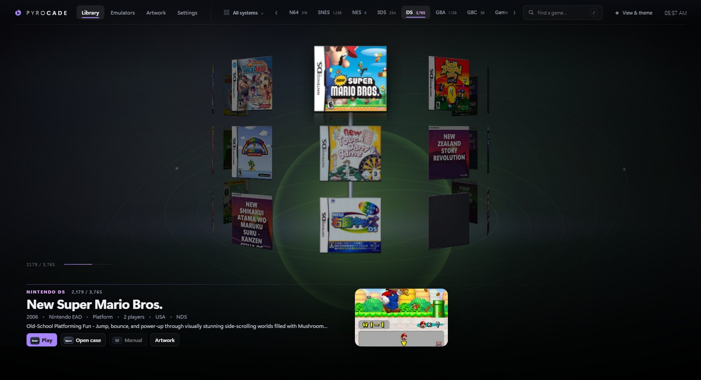
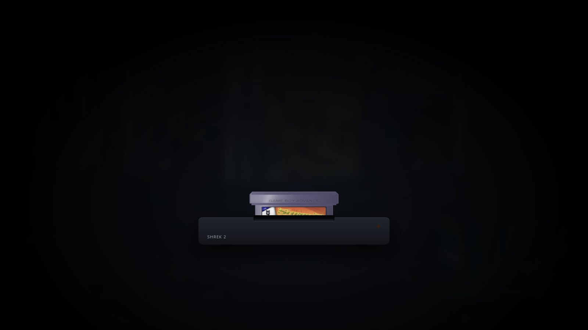
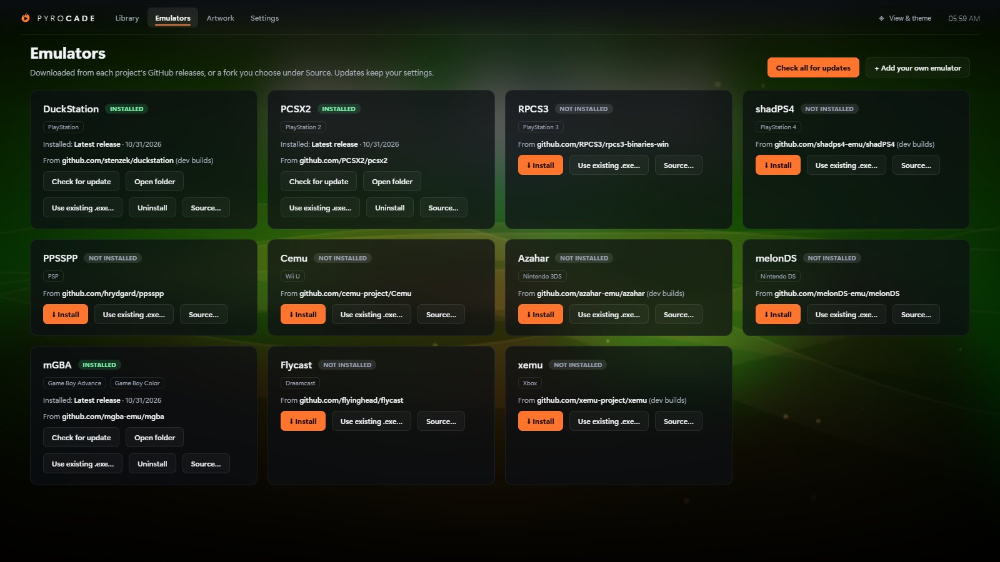

# PyroCade


An emulator front end for Windows, macOS and Linux that shows your games as real 3D boxes, with discs and cartridges, retail-style spines and manuals. It also installs and updates your emulators for you.


| Bookshelf | Spinner rack |
| --- | --- |
|  |  |
| **Open the case** | **Read the manual** |
|  |  |
| **Press Play** | **Emulators** |
|  |  |

## Features
- **Six ways to browse:** Carousel, Bookshelf, Spinner rack, Vertical stack, Flipbook and Colour cards, in five colour themes. Choose them in **View & theme**.
- **Physical games:**
  - Each system gets its own case, from jewel cases, DVD cases and Switch cases to cardboard boxes.
  - Discs and cartridges slide out of the selected case.
  - Generated spines follow each console's retail design, and real spine scans always win.
  - Open a case to turn it around, flip it and read the manual.
- **Start animation:** pressing Play spins the disc into a drive, or pushes the cartridge half-way into its slot, then starts the game. You can turn it off in Settings.
- **Sharp artwork, no account needed:**
  - Covers, back covers, spines, disc scans, cartridge labels, clear logos, background art and screenshots come from the [LaunchBox Games Database](https://gamesdb.launchbox-app.com/), with GameTDB and Libretro as fallbacks.
  - Game descriptions, years, developers and genres fill in automatically.
  - If a match is wrong, **Artwork → Change an image → Other versions…** lets you pick another.
  - [ScreenScraper](https://www.screenscraper.fr/) can be added with your own login.
- **Manuals:** PDF manuals open inside PyroCade. PyroCade finds them next to your ROMs (for example `00 Goodies\Manuals`), matches a whole folder with **Find manuals in a folder…**, or downloads them from ScreenScraper.
- **PC games and your own systems:**
  - Point **PC Games** at a folder of shortcuts (`.lnk`, Steam `.url`) or game programs (`.exe`), and they start directly, with no emulator.
  - **Settings → Add game…** adds any single game file to any system.
  - **Settings → Add system…** creates your own system with its own colour, case style, file types and emulator.
- **Emulators:**
  - Install and update DuckStation, PCSX2, RPCS3, shadPS4, PPSSPP, Cemu, Azahar, melonDS, mGBA, Flycast and xemu from their official GitHub releases.
  - Any emulator can download from a fork instead (**Source…**).
  - **Add your own emulator** accepts any GitHub repository, or a program you already have.
- **Controllers:** Xbox, PlayStation, Nintendo and generic pads, with 283 matching button prompts that follow the last input you used.
- **Ambient mode:** animated backgrounds (XMB ribbon, pixel-art day and night and more), and after a few idle minutes the interface fades into a screensaver.

## Install
**Windows:** download **PyroCade-Setup-x.y.z.exe** from the [latest release](https://github.com/Pyrodrifter/PyroCade/releases/latest) and run it. The installer isn't code-signed yet, so Windows SmartScreen may say "Windows protected your PC": click **More info → Run anyway**. Settings, emulators and artwork are kept in `%APPDATA%\PyroCade\data`. PyroCade checks for new releases when it starts and can update itself.

**macOS:** download **PyroCade-x.y.z-arm64.dmg** for Apple Silicon (M1 and newer), or **PyroCade-x.y.z-x64.dmg** for Intel Macs. Open it and drag PyroCade to Applications. PyroCade isn't notarized by Apple yet, so the first time you open it macOS blocks it.
1. Open **System Settings → Privacy & Security**.
2. Scroll down and click **Open Anyway** next to PyroCade.

If macOS says the app is damaged, run `xattr -cr /Applications/PyroCade.app` in Terminal once. Data lives in `~/Library/Application Support/PyroCade/data`. On a Mac, link the emulators you already have with **Use existing .exe…**, which accepts `.app` bundles such as Dolphin.app. The automatic emulator downloads are Windows and Linux only for now.

**Linux:** every release has 64-bit builds.

| Distribution | Download | Install |
| --- | --- | --- |
| **SteamOS** (Steam Deck) and any distro | `PyroCade-x.y.z-x86_64.AppImage` | In Desktop Mode, right-click the file → Properties → Permissions → *Is executable*, then open it. For Game Mode, add it with *Add a Non-Steam Game*. |
| **Ubuntu**, Debian, Linux Mint, Pop!_OS | `pyrocade_x.y.z_amd64.deb` | `sudo apt install ./pyrocade_x.y.z_amd64.deb` |
| **Fedora**, Nobara, openSUSE | `pyrocade-x.y.z.x86_64.rpm` | `sudo dnf install ./pyrocade-x.y.z.x86_64.rpm` |
| **Arch**, Manjaro, EndeavourOS, CachyOS | `pyrocade-x.y.z-x86_64.pkg.tar.zst` | `sudo pacman -U ./pyrocade-x.y.z-x86_64.pkg.tar.zst` |

On Linux, data lives in `~/.config/PyroCade/data` and the emulator downloader installs the official AppImages. The AppImage updates itself; the other packages show an update banner. On Ubuntu 24.04 and newer, prefer the .deb, because Electron AppImages need `--no-sandbox` there.

## Getting started
1. **Settings:** set a ROM folder for each system (use **+ Add** for more than one), pick its emulator and click **Save & rescan**. For PC games, choose **Run the file itself** as the emulator.
2. **Emulators:** click **Install** for the emulators you need, or **Use existing .exe…** for ones you already have.
3. **Artwork:** choose **Entire library** and **Download artwork**. The first download fetches LaunchBox's game list once (about 100 MB, refreshed monthly). Turn on **Replace low-resolution covers** to sharpen art you already have.

**Controls:**
- **Keyboard:** ← → browse, ↑ ↓ switch system, **Enter** play, **Space** open the case, **M** manual, **/** search, **Ctrl+K** all systems, **F11** fullscreen.
- **Controllers:** the matching buttons work, and LB/RB switch system.

### Your own artwork
Your own files always win over downloads. PyroCade reads:
- **Folder-per-game:** `front.png`, `back.png`, `spine.png`, `disc.png`, `logo.png`, `fanart.jpg`, `screenshot.png`, `manual.pdf`, `video.mp4`, `info.json`;
- **ES-DE / Skraper folder layouts**, including in a subfolder of your ROM folder;
- **`gamelist.xml`** files.

To set one image for one game, use **Artwork → Change an image**. Downloaded images are scaled to sensible sizes and stored in `data/media/<system>/`.

## Run from source
```bash
npm ci
npm start
```
On Windows you can also double-click `start.bat`. Build the installer with `npm run dist` (output in `dist/`).

**Checks:**
- `npm run artwork:check`, `npm run carousel:check`, `npm run prompts:check` and `npm run brand:check` run on every pull request.
- `npm run ui:check` and `npm run eshop:check` use covers from your local `data/` folder.
- `npm run docs:screens` recreates the screenshots from the demo shelf (handy when you have no library at hand).

**Releasing:** raise `version` in `package.json`, commit, and push a tag `v<version>`. The **Release** workflow builds the Windows installer and Linux packages, smoke-tests Linux and attaches everything to a draft release. Publish the draft and installed copies offer the update.

## Your data stays local
Everything personal lives in `data/` and is never part of this repository:
- `config.json`: ROM folders and emulator paths. A ScreenScraper password is stored encrypted.
- `emulators/`: emulators installed by PyroCade.
- `media/`: downloaded artwork.

## Legal
PyroCade is only a launcher. It does not include or download games, BIOS files or console firmware/keys. Use dumps of games and systems you own. Emulators come from their own official GitHub releases, or a fork you choose, and remain under their own licenses. Artwork and game details come from the LaunchBox Games Database, GameTDB, Libretro thumbnails and (optionally) ScreenScraper, and belong to their respective owners. The screenshots show a personal library with artwork downloaded through PyroCade; the Emulators shot uses the demo setup.

## License
MIT. See [LICENSE](LICENSE). Changes are listed in the [changelog](CHANGELOG.md).
