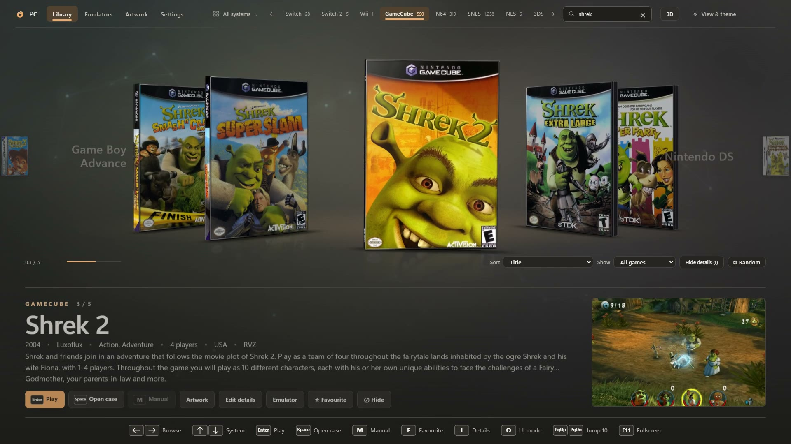

# PyroCade

A glass-styled emulator front end with a 3D library, animated physical media, six browsing layouts and a built-in emulator downloader and updater.

**[Watch the 35-second demo](docs/media/pyrocade-demo.mp4)** · [Appearance & sound](#library-appearance-and-sound) · [Controller support](#button-prompts) · [Screenshots](#screenshots)

## Supported platforms

| Platform | Artifact | Validation |
| --- | --- | --- |
| macOS ARM64 | DMG | Native ARM64 build and install smoke test in the release workflow. |
| Linux ARM64 | AppImage, `.deb`, `.rpm` | Native ARM64 build and package install smoke test in the release workflow. |
| Android ARM64 | CI-only unsigned `arm64-v8a` APK for pull requests; signed APK on release runs | Signed release APKs are attached to GitHub releases. On-device renderer, controller navigation, and Web Audio startup were checked on an Odin2 running Android 13; see [platform validation](docs/SUPPORT.md). |

The Android app requires Android 7.0 (API 24) or newer. Settings and managed data use app-private storage, and PyroCade does not request broad external-storage access. ROM-folder selection uses Android's Storage Access Framework; linked Android emulator apps can be launched with the selected ROM URI. Android emulator packages are separate apps, not the desktop executables managed by the macOS/Linux downloader. See [platform validation](docs/SUPPORT.md) for tested-device details and remaining validation limits.

Download desktop builds and the signed Android APK from the [latest release](https://github.com/Pyrodrifter/PyroCade/releases/latest).

## Run from source

    npm ci
    npm start

Build macOS or Linux ARM64 releases with `npm run dist:macos:arm64` or `npm run dist:linux:arm64`. For Android, install the Android SDK/NDK and JDK 17, then run:

    ANDROID_HOME=/path/to/android-sdk ANDROID_SDK_ROOT=/path/to/android-sdk npm run tauri:android:init
    ANDROID_HOME=/path/to/android-sdk ANDROID_SDK_ROOT=/path/to/android-sdk npm run tauri:android:configure
    ANDROID_HOME=/path/to/android-sdk ANDROID_SDK_ROOT=/path/to/android-sdk RUSTC="$(rustup which rustc)" npm run dist:android:arm64

The Android build targets ARM64, compiles against API 36, targets API 35, and emits split APKs. The CI job pins the JDK and Android SDK components used for its build; release APKs use the configured CI keystore, while pull-request APKs are unsigned.

## Releasing an update

Raise `version` in `package.json`, commit, then push a tag `v<version>` (for example `git tag v0.3.0 && git push origin v0.3.0`). The **Release** GitHub Action validates the Rust app, builds macOS/Linux ARM64 packages and a signed Android ARM64 APK, smoke-tests desktop installs, and attaches artifacts to a draft release. Signed Tauri self-updates are limited to the configured macOS and Linux artifacts; Android updates use manual release downloads.

## Brand assets
The flame and play-button mark, glass app icon, wordmark and banner are in `renderer/assets/brand/`. The set includes SVG masters, PNG icons from 16 to 1024px, a transparent wordmark and a multi-resolution Windows `.ico`. The header mark follows the selected colour theme. Rebuild the complete set with `npm run brand:build`.

## Use
- **Settings**: set a ROM folder for each system, pick its emulator, then click *Save & rescan*. **+ Add system…** creates your own systems (colour, case style, file types, removable); **+ Add game…** adds any file to any system under *Games you added*; the per-system **Show** checkbox hides a system and its games from every shelf. *Hidden games* in Settings lists hidden games with **Restore**.
- **Emulators**: *Install* downloads the latest managed build for your operating system and CPU architecture into `data/emulators/<id>`. *Check all for updates* compares your copy with the newest release, and updates are copied over the old files so emulator settings survive. *Use existing .exe…* links an emulator you already have. *Add your own emulator* covers anything not in the list (Eden, Dolphin, RetroArch…). Any system can use **Run the file itself**.
- **Library**: ← → to browse, ↑ ↓ to switch system in Carousel/Flipbook, Enter to play, Space to open the case, M for the manual. Vertical stack uses ↑ ↓ to browse; Media carousel uses the arrow keys to browse discs and cartridges directly. Controllers work too (A play, B back, Y case, X manual, LB/RB system). Press **F** to favourite a game, **Delete** to hide it (nothing in your ROM folder is renamed, moved or deleted), use the filter buttons for Favourites / Recently played, and cycle sort modes from the shelf. Drag a game to reorder it (Custom sort). Right-click a game for *Rename…*, *Edit details…* (title, version, media type), *Emulator…* (per-game choice or *Run the file itself*) and artwork; the info bar carries the same **Favourite**, **Hide**, **Emulator** and **Edit details** controls.

## Library appearance and sound

The compact 36px systems rail uses translucent glass, console icons, short labels and game counts. Scroll it with the mouse wheel, the edge arrows, or focus it and use the arrow keys. Full names appear in tooltips and in **All systems**. **Ctrl+K** opens the searchable system browser; the controller Menu/Start button opens it too. Configured empty systems remain available. Press **/** to search games and use the × button or Escape to clear the search.

Open **View & theme** in the header for live changes that save automatically:

- **Carousel**, **Vertical stack**, **Flipbook**, **Bookshelf**, **Page turn** and **Media carousel** offer different browsing layouts. Every view keeps Play, Open case, Manual and Artwork controls. Media carousel shows each game's disc or cartridge instead of its case; Page turn swings cases across a spine like a book.
- **Ember**, **Glacier**, **Violet**, **Mint** and **Rose** change the accents, highlights and ambient lighting.
- **Interface sound** controls synthesized scroll ticks, system-change tones, confirmations, case opening/closing and launch/error cues. Sound starts at 25%; mute, adjust the slider or use Test to preview. Cues are short, throttled and generated locally without downloaded audio or background music.

Keyboard and controller navigation follow the chosen layout. In the system browser, the controller's west face button opens appearance controls; use the D-pad/stick to choose layouts/themes or adjust volume. All visual motion still follows **Settings → Interface motion**. Run `npm run ui:check` to verify navigation, layouts, themes, saved settings, minimum-window sizing and offline-rendered sound.

## Screenshots

| Carousel | Bookshelf |
| --- | --- |
|  |  |
| **Page turn** | **Media carousel** |
|  |  |
| **Open the case** | **Emulators** |
|  |  |

Screenshots are illustrative of the six layouts and are copied from the upstream showcase; they are not re-captured from the Tauri build on this host. Recreate them with `npm run docs:screens` where the demo capture harness can run, then review against the Tauri WebView.

## Button prompts
The frontend includes **283 matching prompts** for Xbox, PlayStation, Nintendo, generic gamepads, keyboard and mouse. Hints and action buttons automatically follow the last input used. Choose a fixed family in **Settings → Button prompts**, then **Save & rescan** to keep it. Face-button actions use physical positions: Nintendo B plays and A goes back. Triggers jump ten games in the library and zoom in the case viewer; the top face button opens/closes the case lid.

Browse the complete set in `renderer/assets/prompts/preview.html`. Scalable SVGs, transparent 64/128 px PNGs, the inventory and usage notes are in `renderer/assets/prompts/`. Rebuild with `npm run prompts:build`, export PNGs with `npm run prompts:export`, and verify integration with `npm run prompts:check`.

## Living carousel
Selecting a game reveals its physical media after a short pause: discs slide out from behind the case, and cartridges lift out with system-specific shells for Nintendo handhelds, Switch, NES/SNES/N64, Sega and Atari. The shelf uses six-sided boxes with cover art, spines, depth, soft reflections and a gentle idle movement. The full case viewer uses the same disc and cartridge models.

Cartridges have separate molded contours and label layouts for 12 systems: black Switch and red Switch 2 cards, DS/3DS cards with their corner cuts and tabs, the three Game Boy shells, NES, SNES, N64, Genesis and Atari 2600. Shell thickness follows each contour, with embossed details and grip grooves; exposed gold contacts are omitted. Preview the models with `npx electron scripts/preview-cartridges.cjs` (`output/cartridge-models.png`).

Boxes use system packaging profiles: clear jewel cases and hinges, coloured plastic rims, slim Switch cases, DS/3DS cases and folded cardboard boxes with appropriate thicknesses. Cardboard opens at the top, and its cartridge lifts through the flap. Generated spines use system branding, colours, fitted titles and publisher text when available; PS2 filename regions select light PAL or dark US/Japanese layouts. Switch 2 spines carry artwork around the side. Real spine scans always take priority. These generated layouts approximate the packaging when a scan is missing; they are not reproductions of each title's original printed spine. Preview and verify with `npx electron scripts/preview-packaging.cjs` (`output/packaging-models.png`).

Raised bevels and layered rim highlights give the shells more depth while leaving cover files intact. Jewel cases, plastic and cardboard have different surface finishes. Move the pointer across the selected box for a soft moving highlight; reduced motion keeps it static. The shelf adds a faint cover reflection and a contact shadow. Open plastic cases include booklet clips and closure latches.

Use the on-screen arrows, mouse wheel, keyboard or controller to browse. Fast scrolling cancels old reveal animations. The shelf resizes around the title, description and screenshot so game details and button prompts remain visible. **Settings → Interface motion** follows Windows by default; choose **Reduced** for instant previews without idle movement, or **Full** for animated media and light. Save & rescan keeps the preference. PyroCade opens on the library it found last time and rescans your folders in the background, redrawing the shelf only if something changed.

Run `npm run carousel:check` for the isolated interaction and layout check. It verifies disc/cartridge reveal, box depth, rapid selection, case open/close cancellation, keyboard focus, empty search, reduced motion and the minimum 1100 × 650 window. Captures are saved under `output/`.

## Artwork
Box art and screenshots download automatically from the free libretro thumbnail archive as you browse, and are cached in `data/media/<system>/covers` and `screenshots`. Your own artwork always wins. See Settings → *Artwork folders*. Both folder-per-game (`front.png`, `back.png`, `spine.png`, `disc.png`, `manual.pdf`, `screenshot.png`, `fanart.jpg`, `video.mp4`, `info.json`) and ES-DE/Skraper layouts are supported, as is `gamelist.xml`. Anything missing gets generated art.

Use the **Artwork** tab for explicit downloads. Choose **Selected game**, **One system**, or **Entire library**, select covers/screenshots/title screens, then **Download artwork**. The **Artwork** button beside Play opens the downloader for that game. Downloads update the library as they arrive; the tab shows progress, recent results, kept images, unavailable matches, unsupported systems and errors. **Cancel download** stops the batch; start again to continue because completed files are kept. A running batch can also be followed after navigating away or reloading the renderer.

**Refresh matches and retry missing artwork** retrieves fresh source lists and retries previous misses. Existing art is never replaced. Custom artwork in your configured artwork folder or ROM folders takes priority over the download cache. Covers no longer prevent missing screenshots from downloading. Title screens are stored in `data/media/<system>/titlescreens` and shown when no gameplay screenshot is available. **Open artwork folder** opens the download cache.

The built-in sources require no account or API key. The public [Libretro thumbnail archive](https://docs.libretro.com/guides/roms-playlists-thumbnails/) provides covers, gameplay screenshots and title screens for supported retro systems. **Nintendo Switch uses [GameTDB](https://www.gametdb.com/Switch/downloads)** for box covers, back covers and cartridge labels. Choose Nintendo Switch in Artwork, select the available image types, and click Download artwork. Switch screenshots and title screens are disabled because GameTDB does not supply them. Product names are matched after removing filename tags and version numbers; available US, English and Japanese artwork is tried in that order. For a front cover when Libretro and GameTDB have no match, PyroCade also asks the [Super Mario Wiki](https://www.mariowiki.com/) (Mario-series games) and the [Internet Archive](https://archive.org/details/softwareboxart) box scans as a last resort, front covers only, never replacing an existing cover. JPEG covers are normalized to PNG.

For any game without a match, open its **Artwork** button and use **Use your own image → Choose image…**. Choose the artwork type, then pick a PNG, JPG or WebP file. The selected type is explicitly replaced and the library updates immediately. This also works for Switch 2 and systems without a downloader source. Images are copied into a per-game artwork folder, so they survive rescanning and restarting; downloads continue to preserve them. Spines, manuals, videos and other images not provided by the selected source can still be supplied through artwork folders.

GameTDB's red eShop placeholders get an art-first sleeve with larger game artwork, readable titles and a matching cartridge preview. Higher-resolution artwork is cached separately in `data/media/switch/cover-hq`; original downloads stay intact. Choose **Settings → eShop covers → Original downloaded cover** to restore the source presentation. The same sleeve appears in the carousel and case viewer. Run `npm run eshop:check` to verify detection, display, settings and preservation of the originals.

Switch 2 covers can be supplied through **Use your own image**. Square product photos are fitted to the case by trimming their white side margins in the display. Switch 2 does not yet have an automatic download provider. Game artwork is cached locally and is not included in the repository.

Run `npm run artwork:check` to verify the download service and the integrated UI without modifying your ROMs, emulator settings or real artwork.

## Emulator catalog

Managed emulator downloads are selected by operating system and CPU architecture. The release catalog currently provides macOS and Linux ARM64 packages; Android builds do not offer desktop executables as Android emulator apps. Custom executable linking and process launching are native-path operations and are not a substitute for installing and launching an Android emulator application.

## Report a problem or send feedback

Open **Settings → Feedback → Report a problem or suggest a change**. Choose a problem report or a suggestion, add a summary and description, and use **Continue on GitHub** to review and submit it in your browser. A GitHub account is required, and reports are public. You can attach screenshots on GitHub before submitting.

The form shows the PyroCade version, OS/release/arch, Tauri version and installation that will be included; uncheck the option to leave them out. Logs, local paths, credentials and your game library are not attached automatically. **Copy report** works offline and lets you paste the report into a message or a [new issue](https://github.com/Pyrodrifter/PyroCade/issues/new/choose). You can also report directly using the repository's problem and feedback templates.

## Your data stays local

Settings, emulator files and downloaded artwork stay in PyroCade's per-user app-data directory; on Android they remain in the app-private data directory. Personal data is not part of this repository.

## Legal
PyroCade is only a launcher. It does not include or download games, BIOS files or console firmware/keys. Use dumps of games and systems you own. Emulators are downloaded from their own official GitHub releases and remain under their own licenses.

## License
MIT. See [LICENSE](LICENSE).
