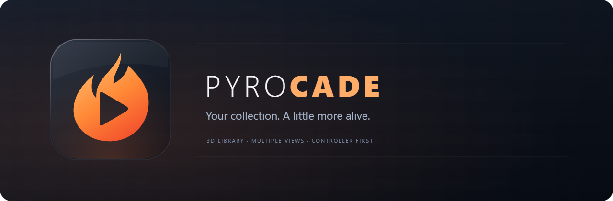
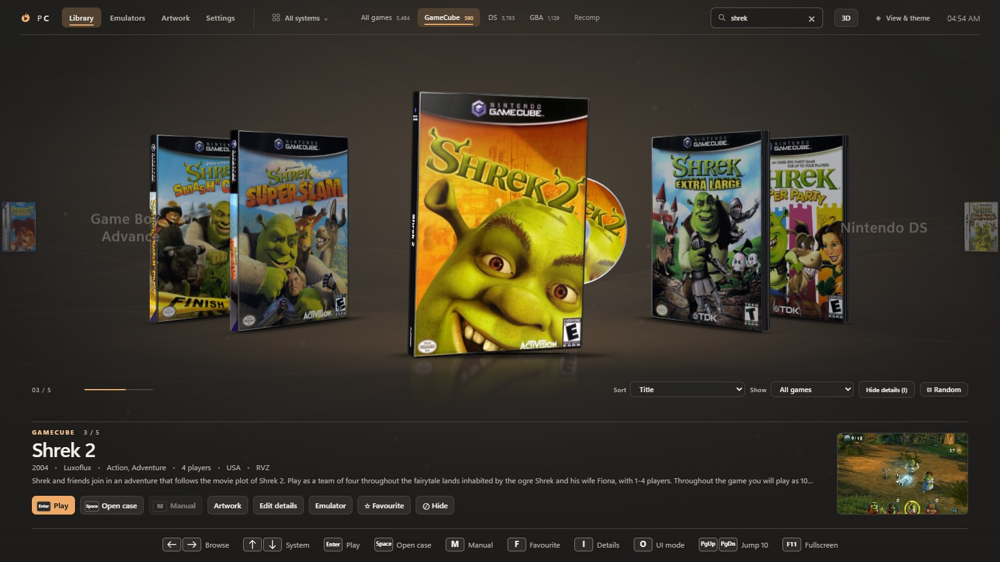
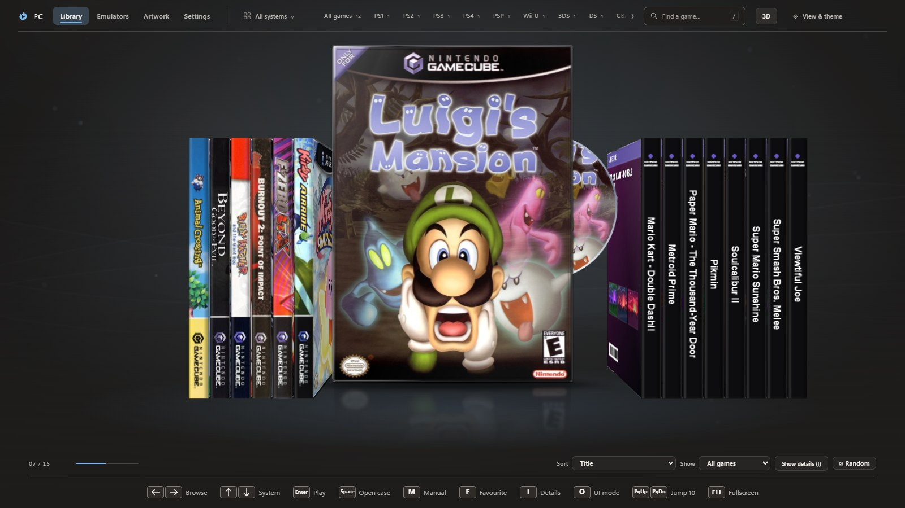
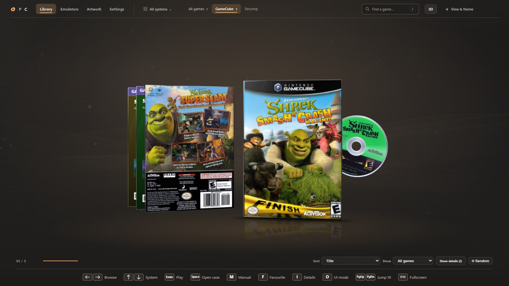
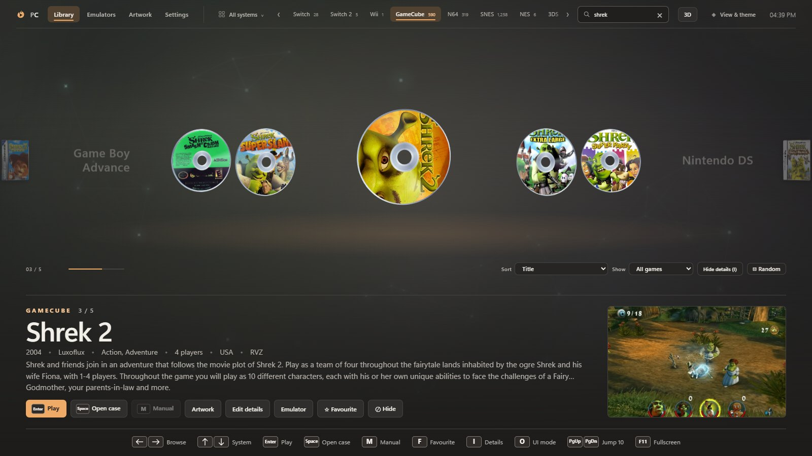
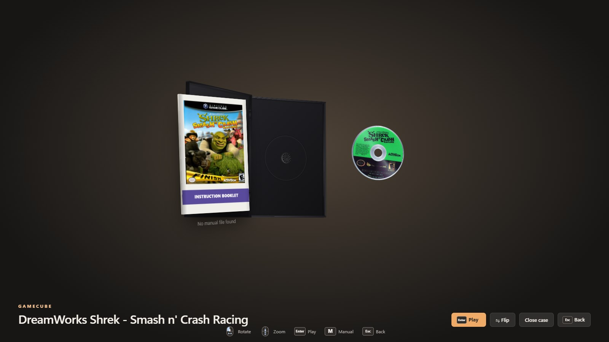
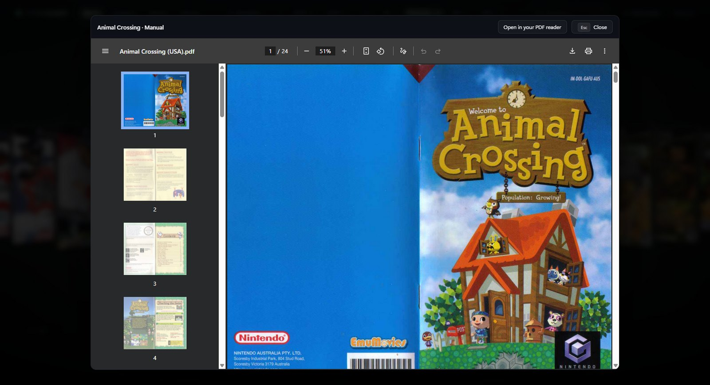
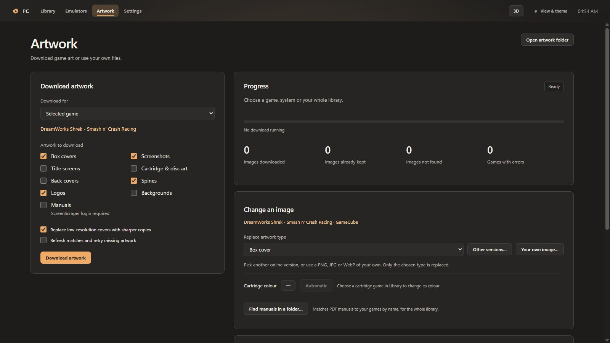

# PyroCade



An emulator launcher for Windows, macOS and Linux. Browse your library as 3D game cases with spines, cartridges, discs and manuals. Install or link emulators from the same app.



The 20-second demo moves from GameCube cases and discs to PlayStation jewel cases, then opens the **Golden Sun** box to reveal its Game Boy Advance cartridge. [Download the demo (MP4)](docs/media/pyrocade-demo.mp4?raw=true)

| Bookshelf | Page turn |
| --- | --- |
|  |  |
| **Media carousel** | **Open the case** |
|  |  |
| **Manuals** | **Artwork** |
|  |  |
| **Emulators** | |
|  | |

## Features
- **Six library layouts.** Choose Carousel, Bookshelf, Vertical stack, Flipbook, Page turn or Media carousel in **View & theme**. Page turn swings cases across a spine. Media carousel shows each game's disc or cartridge instead of its case. Pick an accent colour and background there too.
- **Physical games.**
  - Each system gets its own case, from jewel cases, DVD cases and Switch cases to cardboard boxes.
  - Discs slide out of the selected case, and cartridges rise above the cover so you can see the label. In the case view, a cartridge comes up out of its cardboard box and settles in front of it.
  - **Cartridges come in their real colours:** taken from a photo of the actual cartridge, or from a list of famous ones (gold Ocarina of Time, the coloured Pokémon cartridges…). You can also pick your own colour per game in **Artwork → Change an image**.
  - Generated spines follow each console's retail design, and real spine scans always win.
  - Open a case to turn it around, flip it and read the manual. The booklet inside is printed like that system's real manuals, in its retail colours.
- **Library controls.**
  - **Favourites** (press **F**) and **Recently played** get their own shelves.
  - **Play time** and **last played** show with each game.
  - **Sort** by title, year, play time or developer, **show** only multiplayer, unplayed or one genre, or pick a **random** game.
  - **Hide a game** you don't want on the shelf (**⊘ Hide**, or the **Delete** key) without touching your ROM folder; **Show → Hidden games** brings it back.
  - Right-click a game to rename it, edit its version or media type, choose artwork, or open its folder.
  - Browse past a console’s last game to move into the next shelf. Edge previews show which console is next. Drag games within a console to set a custom order.
  - Press **I** to hide or show game details. The shelf expands when details are hidden. Drag the top edge of the details panel to resize it. Press **O** to toggle the overlay.
  - PyroCade opens on the system and game you had selected.
- **Multi-disc games** are one game with a disc choice in the case view. **Your own screenshots** from the emulator appear under the open case.
- **Launch animation.** Play slides the disc or cartridge into a slot before the game starts. Toggle it in **Settings → Library display**. [Castlevania: Aria of Sorrow cartridge launch](docs/media/screen-launch.jpg)
- **Sharp artwork, no account needed:**
  - Covers, back covers, spines, disc scans, cartridge labels, clear logos, background art and screenshots come from the [LaunchBox Games Database](https://gamesdb.launchbox-app.com/), with GameTDB and Libretro as fallbacks. Front covers none of those have can still come from the [Super Mario Wiki](https://www.mariowiki.com/) (Mario-series games) and the [Internet Archive](https://archive.org/details/softwareboxart)'s box scan collection.
  - Game descriptions, years, developers and genres fill in automatically.
  - If a match is wrong, **Artwork → Change an image → Other versions…** lets you pick another.
  - [ScreenScraper](https://www.screenscraper.fr/) can be added with your own login.
- **Manuals:** PDF manuals open inside PyroCade. PyroCade finds them next to your ROMs (for example `00 Goodies\Manuals`), matches a whole folder with **Find manuals in a folder…**, or downloads them from ScreenScraper.
- **PC games and your own systems:**
  - Point **PC Games** at a folder of shortcuts (`.lnk`, Steam `.url`) or game programs (`.exe`), and they start directly, with no emulator.
  - **Settings → Add game…** adds any single game file to any system.
  - **Settings → Add system…** creates your own system with its own colour, case style, file types and emulator.
  - **Settings → Recomp game…** adds a standalone Windows game. Pick its folder and choose the game’s executable.
- **Emulators:**
  - Install and update DuckStation, PCSX2, RPCS3, shadPS4, PPSSPP, Cemu, Azahar, melonDS, mGBA, Flycast and xemu from their official GitHub releases.
  - Any emulator can download from a fork instead (**Source…**).
  - **Add emulator** accepts any GitHub repository, or a program you already have.
  - **One game, its own emulator:** the **Emulator** button next to Play picks an emulator for just that game, for example a fork made for Ocarina of Time. Other games keep the system's emulator.
- **Button prompts.** Flat keyboard, mouse, Xbox, PlayStation, Nintendo and generic gamepad icons follow the last input you used. [Full prompt set](renderer/assets/prompts/preview.html)
- **Ambient mode.** Choose a background and an idle delay for the screensaver.
- **Performance settings.** Use **Settings → Interface → Use flat covers** or **Disable animations** to reduce rendering work. Both apply immediately.
- **Fast with large libraries.** PyroCade opens on the library it found last time and rescans your folders in the background, redrawing the shelf only if something changed. Scans read folders in parallel, list each folder once and remember the file sizes used to choose between copies of a game. Generated back covers are drawn in the background, so switching consoles stays quick.
- **Leia SR on Windows.** Press **F9** to toggle stereo and **Shift+F9** for depth, popout, convergence and stereo FPS. Stereo requires a compatible display, the Leia SR runtime and the native presenter. [Native presenter build instructions](native/README.md)

## Install
**Windows:** download **PyroCade-Setup-x.y.z.exe** from the [latest release](https://github.com/Pyrodrifter/PyroCade/releases/latest) and run it. The installer isn't code-signed yet, so Windows SmartScreen may say "Windows protected your PC": click **More info → Run anyway**. Settings, emulators and artwork are kept in `%APPDATA%\PyroCade\data`. PyroCade checks for new releases when it starts and can update itself.

**macOS:** download **PyroCade-x.y.z-arm64.dmg** for Apple Silicon (M1 and newer), or **PyroCade-x.y.z-x64.dmg** for Intel Macs. Open it and drag PyroCade to Applications. PyroCade isn't notarized by Apple yet, so the first time you open it macOS blocks it.
1. Open **System Settings → Privacy & Security**.
2. Scroll down and click **Open Anyway** next to PyroCade.

If macOS says the app is damaged, run `xattr -cr /Applications/PyroCade.app` in Terminal once. Data lives in `~/Library/Application Support/PyroCade/data`. On a Mac, link the emulators you already have with **Use existing .exe…**, which accepts `.app` bundles such as Dolphin.app. The automatic emulator downloads are Windows and Linux only for now.

**Linux:** every release has 64-bit builds.

| Distribution | Download | Install |
| --- | --- | --- |
| **SteamOS** (Steam Deck) and any distro | `PyroCade-x.y.z-x86_64.AppImage` | In Desktop Mode, right-click the file → Properties → Permissions → *Is executable*, then open it. For Game Mode, add it with *Add a Non-Steam Game*. |
| **Ubuntu**, Debian, Linux Mint, Pop!_OS | `pyrocade_x.y.z_amd64.deb` | `sudo apt install ./pyrocade_x.y.z_amd64.deb` |
| **Fedora**, Nobara, openSUSE | `pyrocade-x.y.z.x86_64.rpm` | `sudo dnf install ./pyrocade-x.y.z.x86_64.rpm` |
| **Arch**, Manjaro, EndeavourOS, CachyOS | `pyrocade-x.y.z-x86_64.pkg.tar.zst` | `sudo pacman -U ./pyrocade-x.y.z-x86_64.pkg.tar.zst` |

On Linux, data lives in `~/.config/PyroCade/data` and the emulator downloader installs the official AppImages. The AppImage updates itself; the other packages show an update banner. On Ubuntu 24.04 and newer, prefer the .deb, because Electron AppImages need `--no-sandbox` there.

**Android (experimental):** releases include **PyroCade-x.y.z-android-experimental.apk**, a debug-signed proof of concept of the same library. Allow installs from your browser or file manager, open the APK, then tap **Choose ROM folder…**. Artwork download, manuals and the updater aren't available on Android yet, and launching an emulator hasn't been confirmed on a real phone. [Status and build notes](docs/android.md)

## Getting started
1. **Settings:** set a ROM folder for each system (use **+ Add** for more than one), pick its emulator and click **Save & rescan**. For PC games, choose **Run the file itself** as the emulator.
2. **Emulators:** click **Install** for the emulators you need, or **Use existing .exe…** for ones you already have.
3. **Artwork:** choose **Entire library** and **Download artwork**. The first download fetches LaunchBox's game list once (about 100 MB, refreshed monthly). Turn on **Replace low-resolution covers** to sharpen art you already have.

**Controls:**
- **Keyboard:** ← → browse, ↑ ↓ switch system or browse in Vertical stack, **Enter** play, **Space** open the case, **M** manual, **F** favourite, **Delete** hide, **/** search, **Ctrl+K** all systems, **I** show or hide details, **O** toggle the overlay, **F11** (or **Ctrl/Cmd+Shift+F**) fullscreen.
- **Mouse:** click a game to select it, click it again to open the case, **right-click** for its menu.
- **Controllers:** the matching buttons work, LB/RB switch system, Select stars a game and the left stick button picks a random one. While a game is running, hold **Select + Start** for 1.5 seconds to close it.

Use **Settings → Quit application** to close PyroCade, including in fullscreen mode.

### Supported systems
Each system's file types and emulator can be changed in **Settings**, and **Add system…** adds any system that isn't listed.

| System | File types | Built-in emulator download |
| --- | --- | --- |
| PlayStation | `.m3u` `.cue` `.chd` `.pbp` | DuckStation |
| PlayStation 2 | `.iso` `.chd` `.cso` `.gz` | PCSX2 |
| PlayStation 3 | `.iso` | RPCS3 |
| PlayStation 4 | `.pkg` | shadPS4 |
| PSP | `.iso` `.cso` `.chd` | PPSSPP |
| Nintendo Switch | `.nsp` `.xci` `.nsz` | Link your own |
| Nintendo Switch 2 | `.nsp` `.xci` `.nsz` `.xcz` `.nup` | Link your own |
| Wii U | `.wua` `.wud` `.wux` `.rpx` | Cemu |
| Wii | `.rvz` `.wbfs` `.iso` | Link your own |
| GameCube | `.rvz` `.iso` `.gcm` `.ciso` | Link your own |
| Nintendo 64 | `.z64` `.n64` `.v64` | Link your own |
| Super Nintendo | `.sfc` `.smc` | Link your own |
| NES | `.nes` `.zip` | Link your own |
| Nintendo 3DS | `.3ds` `.cci` `.cxi` `.cia` | Azahar |
| Nintendo DS | `.nds` `.zip` | melonDS |
| Game Boy Advance | `.gba` `.zip` | mGBA |
| Game Boy Color | `.gbc` `.zip` | mGBA |
| Game Boy | `.gb` `.zip` | Link your own |
| Dreamcast | `.chd` `.gdi` `.cdi` | Flycast |
| Sega Genesis | `.md` `.gen` `.smd` `.zip` | Link your own |
| Xbox | `.iso` `.xiso` | xemu |
| Xbox 360 | `.iso` `.xex` `.zar` | Link your own |
| PC Games | `.lnk` `.url` `.exe` | Runs directly |
| Atari 2600 | `.a26` `.zip` | Link your own |
| Arcade | `.zip` | Link your own |

Switch and Switch 2 games can also be unpacked game folders (`<game>\base\exefs\main`). Update and DLC files are listed with the game they belong to rather than as games of their own, using the title ID in the file name (`Game [0100ABCD12345000][v0].nsp`). Systems without a built-in download work with any emulator you link with **Use existing .exe…**.

### Your own artwork
Your own files always win over downloads. PyroCade reads:
- **Folder-per-game:** `front.png`, `back.png`, `spine.png`, `disc.png`, `logo.png`, `fanart.jpg`, `screenshot.png`, `manual.pdf`, `video.mp4`, `info.json`;
- **ES-DE / Skraper folder layouts**, including in a subfolder of your ROM folder;
- **`gamelist.xml`** files.

To set one image for one game, use **Artwork → Change an image**. Downloaded images are scaled to sensible sizes and stored in `data/media/<system>/`.

## Run from source
```bash
npm ci
npm start
```
On Windows you can also double-click `start.bat`. Build the installer with `npm run dist` (output in `dist/`).

**Checks:**
- `npm run artwork:check`, `npm run carousel:check`, `npm run prompts:check` and `npm run brand:check` run on every pull request.
- `npm run ui:check` and `npm run eshop:check` use covers from your local `data/` folder.
- `npm run docs:screens` captures the demo shelf. Set `PYROCADE_SCREENS_DIR` to write those images to a separate folder.

**Releasing:** raise `version` in `package.json`, commit, and push a tag `v<version>`. The **Release** workflow builds the Windows installer with the Leia SR presenter, plus the Linux and macOS packages. It smoke-tests Linux and macOS and attaches the installers to a draft release. Publish the draft and installed copies offer the update.

## Your data stays local
Everything personal lives in `data/` and is never part of this repository:
- `config.json`: ROM folders and emulator paths. A ScreenScraper password is stored encrypted.
- `emulators/`: emulators installed by PyroCade.
- `media/`: downloaded artwork.

## Report a problem or send feedback
Open **Settings → Feedback → Report a problem or suggest a change**. Choose a problem report or a suggestion, add a summary and description, and use **Continue on GitHub** to review and submit it in your browser. A GitHub account is required, and reports are public. You can attach screenshots on GitHub before submitting.

The form shows the app version and basic device details that will be included; uncheck the option to leave them out. Logs, local paths, credentials and your game library are not attached automatically. **Copy report** works offline and lets you paste the report into a message or a [new issue](https://github.com/Pyrodrifter/PyroCade/issues/new/choose). You can also report directly using the repository's problem and feedback templates.

## Thanks

- **[afterkaze](https://www.reddit.com/user/RiceDesperate5724/)** (u/RiceDesperate5724 on Reddit) suggested hiding games without touching the ROM folder and reported the Switch update and DLC counting and fullscreen issues. Their fork introduced continuous carousel navigation, a right-click menu, and renaming. They also contributed Leia SR stereo, carousel previews, drag ordering, game metadata controls, and the Recomp shelf. [Pull request #4](https://github.com/Pyrodrifter/PyroCade/pull/4)

Found something, or want something? [Open an issue](https://github.com/Pyrodrifter/PyroCade/issues) — and if you have already written the fix, a pull request is very welcome.

## Legal
PyroCade is only a launcher. It does not include or download games, BIOS files or console firmware/keys. Use dumps of games and systems you own. Emulators come from their own official GitHub releases, or a fork you choose, and remain under their own licenses. Artwork and game details come from the LaunchBox Games Database, GameTDB, Libretro thumbnails, the Super Mario Wiki, the Internet Archive and (optionally) ScreenScraper, and belong to their respective owners. The screenshots use local library artwork. The Kirby Air Ride booklet links to a local PDF manual. The Emulators shot uses a demo configuration.

## License
MIT. See [LICENSE](LICENSE). Changes are listed in the [changelog](CHANGELOG.md).
